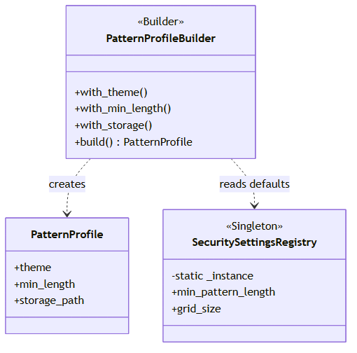

# Отчет 1

Тема: Порождающие паттерны: Одиночка, Строитель

## Исходный код

```python
"""ЛР1: Singleton — единый реестр настроек безопасности."""

from __future__ import annotations


class SecuritySettingsRegistry:
    """Одиночка: один экземпляр настроек графического пароля."""

    _instance: SecuritySettingsRegistry | None = None

    def __new__(cls) -> SecuritySettingsRegistry:
        if cls._instance is None:
            inst = super().__new__(cls)
            inst.min_pattern_length = 4
            inst.grid_size = 3
            inst.hash_salt = "skfu-v8"
            cls._instance = inst
        return cls._instance

    @classmethod
    def reset_for_tests(cls) -> None:
        cls._instance = None
```

```python
"""ЛР1: Builder — пошаговая сборка профиля блокировки."""

from __future__ import annotations

from dataclasses import dataclass, field
from pathlib import Path

from src.patterns.lr01_singleton import SecuritySettingsRegistry


@dataclass
class PatternProfile:
    theme: str
    min_length: int
    storage_path: Path
    allow_jump: bool = True


class PatternProfileBuilder:
    def __init__(self) -> None:
        reg = SecuritySettingsRegistry()
        self._theme = "dark"
        self._min_length = reg.min_pattern_length
        self._path = Path.home() / ".graphical_password_patterns.json"
        self._allow_jump = True

    def with_theme(self, theme: str) -> PatternProfileBuilder:
        self._theme = theme
        return self

    def with_min_length(self, n: int) -> PatternProfileBuilder:
        self._min_length = n
        return self

    def with_storage(self, path: Path) -> PatternProfileBuilder:
        self._path = path
        return self

    def with_jump_rules(self, allowed: bool) -> PatternProfileBuilder:
        self._allow_jump = allowed
        return self

    def build(self) -> PatternProfile:
        return PatternProfile(
            theme=self._theme,
            min_length=self._min_length,
            storage_path=self._path,
            allow_jump=self._allow_jump,
        )
```

## Диаграмма классов



Одиночка и Строитель

## Описание паттернов

Одиночка. Класс SecuritySettingsRegistry хранит настройки графического пароля: минимальную длину шаблона, размер сетки и соль для хеша. При создании объекта проверяется, есть ли уже экземпляр. Если есть, возвращается он же, новый не создаётся.

Строитель. Класс PatternProfileBuilder собирает профиль блокировки по частям: тема оформления, минимальная длина, файл для сохранения и разрешение «перепрыгивать» точки. Метод build() в конце возвращает готовый PatternProfile. Значения по умолчанию берутся из одиночки.
