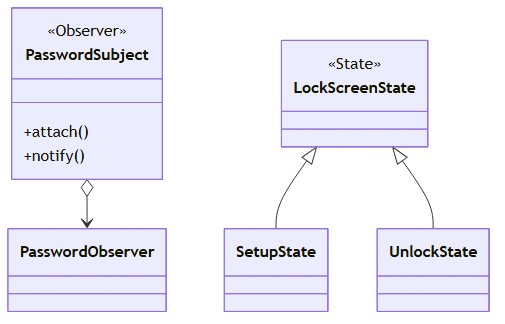

# Отчет 10

Тема: Поведенческие паттерны: Наблюдатель, Состояние

## Исходный код

```python
"""ЛР10: Наблюдатель + Состояние."""

from __future__ import annotations

from abc import ABC, abstractmethod


class PasswordObserver(ABC):
    @abstractmethod
    def on_event(self, event: str) -> None: ...


class PasswordSubject:
    def __init__(self) -> None:
        self._observers: list[PasswordObserver] = []

    def attach(self, obs: PasswordObserver) -> None:
        self._observers.append(obs)

    def notify(self, event: str) -> None:
        for o in self._observers:
            o.on_event(event)


class AuditLogObserver(PasswordObserver):
    def __init__(self) -> None:
        self.events: list[str] = []

    def on_event(self, event: str) -> None:
        self.events.append(event)


class LockScreenState(ABC):
    @abstractmethod
    def on_setup(self, ctx: LockContext) -> str: ...

    @abstractmethod
    def on_unlock(self, ctx: LockContext, points: list[int]) -> str: ...


class SetupState(LockScreenState):
    def on_setup(self, ctx: LockContext) -> str:
        ctx.state = UnlockState()
        ctx.subject.notify("password_configured")
        return "Перешли в режим разблокировки"

    def on_unlock(self, ctx: LockContext, points: list[int]) -> str:
        return "Сначала задайте пароль"


class UnlockState(LockScreenState):
    def on_setup(self, ctx: LockContext) -> str:
        return "Пароль уже задан"

    def on_unlock(self, ctx: LockContext, points: list[int]) -> str:
        ok, msg = ctx.facade.unlock(points)
        event = "unlocked" if ok else "unlock_failed"
        ctx.subject.notify(event)
        return msg


class LockContext:
    def __init__(self, facade) -> None:
        self.facade = facade
        self.subject = PasswordSubject()
        self.state: LockScreenState = SetupState()
```

## Диаграмма классов



Наблюдатель и Состояние

## Описание паттернов

Наблюдатель. PasswordSubject хранит список подписчиков. Когда происходит событие, вызывается notify(), и каждый подписчик получает строку события. AuditLogObserver складывает эти строки в свой список.

Состояние. У экрана блокировки два режима: SetupState и UnlockState. В первом on_unlock отвечает, что пароль ещё не задан, а on_setup переводит контекст во второй режим. Во втором on_unlock уже вызывает проверку пароля.
