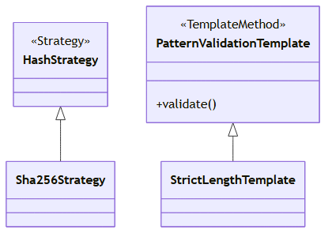

# Отчет 11

Тема: Поведенческие паттерны: Стратегия, Шаблонный метод

## Исходный код

```python
"""ЛР11: Стратегия + Шаблонный метод."""

from __future__ import annotations

import hashlib
from abc import ABC, abstractmethod

from src.domain.pattern import PatternValidationResult, normalize_raw_points


class HashStrategy(ABC):
    @abstractmethod
    def hash_pattern(self, normalized: tuple[int, ...], salt: str) -> str: ...


class Sha256Strategy(HashStrategy):
    def hash_pattern(self, normalized: tuple[int, ...], salt: str) -> str:
        data = "-".join(map(str, normalized)) + ":" + salt
        return hashlib.sha256(data.encode()).hexdigest()


class Sha1Strategy(HashStrategy):
    def hash_pattern(self, normalized: tuple[int, ...], salt: str) -> str:
        data = "-".join(map(str, normalized)) + ":" + salt
        return hashlib.sha1(data.encode()).hexdigest()


class PatternValidationTemplate(ABC):
    """Шаблонный метод: каркас проверки, шаг нормализации общий."""

    def validate(self, points: list[int]) -> PatternValidationResult:
        pre = self.pre_validate(points)
        if pre is not None:
            return pre
        result = normalize_raw_points(points)
        return self.post_validate(result)

    def pre_validate(self, points: list[int]) -> PatternValidationResult | None:
        return None

    @abstractmethod
    def post_validate(self, result: PatternValidationResult) -> PatternValidationResult: ...


class StrictLengthTemplate(PatternValidationTemplate):
    def pre_validate(self, points: list[int]) -> PatternValidationResult | None:
        if len(points) > 9:
            return PatternValidationResult(False, (), "Слишком много точек")
        return None

    def post_validate(self, result: PatternValidationResult) -> PatternValidationResult:
        return result
```

## Диаграмма классов



Стратегия и Шаблонный метод

## Описание паттернов

Стратегия. Хеш шаблона считается через объект с методом hash_pattern. Sha256Strategy считает SHA-256, Sha1Strategy считает SHA-1. Какой класс подставить, выбирается снаружи.

Шаблонный метод. В PatternValidationTemplate метод validate() всегда идёт в одном порядке: сначала pre_validate, потом нормализация точек, потом post_validate. В StrictLengthTemplate первый шаг отсекает список длиннее девяти точек, остальное остаётся общим.
