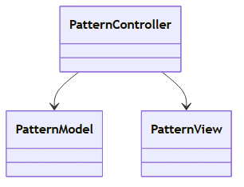

# Отчет 12

Тема: Архитектурный паттерн: MVC

## Исходный код

```python
"""ЛР12: MVC — разделение модели, представления и контроллера."""

from __future__ import annotations

from dataclasses import dataclass, field
from pathlib import Path

from src.patterns.lr05_facade_flyweight import GraphicalPasswordFacade
from src.patterns.lr01_builder import PatternProfileBuilder


@dataclass
class PatternModel:
    facade: GraphicalPasswordFacade = field(
        default_factory=lambda: GraphicalPasswordFacade(
            PatternProfileBuilder().with_storage(Path(".pattern_mvc.json")).build()
        )
    )
    last_message: str = ""

    def set_password(self, points: list[int]) -> bool:
        ok, msg = self.facade.setup(points)
        self.last_message = msg
        return ok

    def verify(self, points: list[int]) -> bool:
        ok, msg = self.facade.unlock(points)
        self.last_message = msg
        return ok


class PatternView:
    def render(self, model: PatternModel) -> str:
        return f"[VIEW] статус: {model.last_message}"


class PatternController:
    def __init__(self, model: PatternModel, view: PatternView) -> None:
        self.model = model
        self.view = view

    def action_setup(self, points: list[int]) -> str:
        self.model.set_password(points)
        return self.view.render(self.model)

    def action_verify(self, points: list[int]) -> str:
        self.model.verify(points)
        return self.view.render(self.model)
```

## Диаграмма классов



MVC

## Описание паттернов

MVC. PatternModel хранит фасад пароля и последнее сообщение. PatternView из этого сообщения собирает строку для экрана. PatternController принимает действия пользователя: action_setup и action_verify меняют модель и сразу возвращают то, что нарисовал View.
