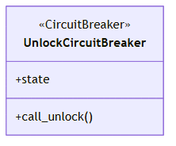

# Отчет 13

Тема: Паттерн микросервисов: Circuit Breaker

## Исходный код

```python
"""ЛР13: Circuit Breaker — защита от лавины неудачных разблокировок."""

from __future__ import annotations

from enum import Enum


class BreakerState(Enum):
    CLOSED = "closed"
    OPEN = "open"
    HALF_OPEN = "half_open"


class UnlockCircuitBreaker:
    def __init__(self, threshold: int = 3) -> None:
        self._threshold = threshold
        self._failures = 0
        self._state = BreakerState.CLOSED

    @property
    def state(self) -> BreakerState:
        return self._state

    def call_unlock(self, unlock_fn, points: list[int]) -> tuple[bool, str]:
        if self._state == BreakerState.OPEN:
            return False, "Circuit breaker OPEN"

        ok, msg = unlock_fn(points)
        if ok:
            self._failures = 0
            self._state = BreakerState.CLOSED
            return ok, msg

        self._failures += 1
        if self._failures >= self._threshold:
            self._state = BreakerState.OPEN
            return False, "Circuit breaker: слишком много ошибок"
        return ok, msg

    def reset(self) -> None:
        self._failures = 0
        self._state = BreakerState.CLOSED
```

## Диаграмма классов



Circuit Breaker

## Описание паттернов

Предохранитель (Circuit Breaker). Класс UnlockCircuitBreaker считает неудачные попытки разблокировки. Пока счётчик меньше порога, состояние CLOSED и вызов уходит в функцию проверки. Когда ошибок набирается достаточно, состояние становится OPEN и следующие вызовы сразу возвращают отказ, без обращения к проверке пароля. reset() снова открывает доступ.
