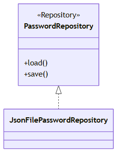

# Отчет 14

Тема: Системный паттерн: Repository

## Исходный код

```python
"""ЛР14: Repository — слой доступа к сохранённому паролю."""

from __future__ import annotations

import json
from abc import ABC, abstractmethod
from dataclasses import dataclass
from pathlib import Path


@dataclass
class StoredPassword:
    pattern_hash: str | None


class PasswordRepository(ABC):
    @abstractmethod
    def load(self) -> StoredPassword: ...

    @abstractmethod
    def save(self, pattern_hash: str) -> None: ...

    @abstractmethod
    def delete(self) -> None: ...


class JsonFilePasswordRepository(PasswordRepository):
    def __init__(self, path: Path) -> None:
        self._path = path

    def load(self) -> StoredPassword:
        if not self._path.is_file():
            return StoredPassword(None)
        data = json.loads(self._path.read_text(encoding="utf-8"))
        return StoredPassword(data.get("hash"))

    def save(self, pattern_hash: str) -> None:
        self._path.parent.mkdir(parents=True, exist_ok=True)
        self._path.write_text(json.dumps({"hash": pattern_hash}, ensure_ascii=False, indent=2), encoding="utf-8")

    def delete(self) -> None:
        if self._path.is_file():
            self._path.unlink()
```

## Диаграмма классов



Repository

## Описание паттернов

Репозиторий. PasswordRepository задаёт три операции: load, save и delete. JsonFilePasswordRepository делает их с JSON-файлом: читает поле hash, записывает его или удаляет файл. Код, которому нужен сохранённый пароль, работает с репозиторием и не открывает файл сам.
