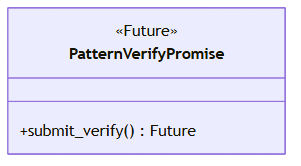

# Отчет 15

Тема: Идиоматический паттерн: Future / Promise

## Исходный код

```python
"""ЛР15: Future/Promise — асинхронная проверка пароля."""

from __future__ import annotations

from concurrent.futures import Future, ThreadPoolExecutor
from typing import Callable


class PatternVerifyPromise:
    def __init__(self, executor: ThreadPoolExecutor | None = None) -> None:
        self._executor = executor or ThreadPoolExecutor(max_workers=2)

    def submit_verify(self, verify_fn: Callable[[list[int]], tuple[bool, str]], points: list[int]) -> Future:
        return self._executor.submit(verify_fn, points)

    def shutdown(self) -> None:
        self._executor.shutdown(wait=False)
```

## Диаграмма классов



Future

## Описание паттернов

Future. PatternVerifyPromise.submit_verify отправляет функцию проверки пароля в пул потоков и сразу возвращает объект Future. Результат (успех и текст) забирается у Future, когда проверка уже закончилась.
