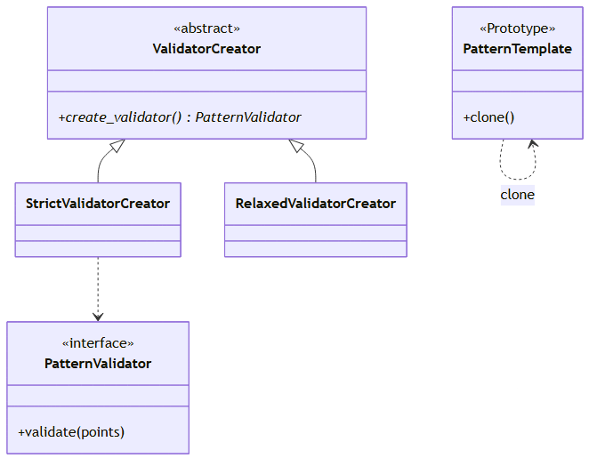

# Отчет 2

Тема: Порождающие паттерны: Фабричный метод, Прототип

## Исходный код

```python
"""ЛР2: Factory Method + Prototype."""

from __future__ import annotations

import copy
from abc import ABC, abstractmethod
from dataclasses import dataclass

from src.domain.pattern import PatternValidationResult, normalize_raw_points


class PatternValidator(ABC):
    @abstractmethod
    def validate(self, points: list[int]) -> PatternValidationResult: ...


class StrictValidator(PatternValidator):
    def validate(self, points: list[int]) -> PatternValidationResult:
        return normalize_raw_points(points, min_length=4)


class RelaxedValidator(PatternValidator):
    def validate(self, points: list[int]) -> PatternValidationResult:
        return normalize_raw_points(points, min_length=3)


class ValidatorCreator(ABC):
    """Фабричный метод."""

    @abstractmethod
    def create_validator(self) -> PatternValidator: ...


class StrictValidatorCreator(ValidatorCreator):
    def create_validator(self) -> PatternValidator:
        return StrictValidator()


class RelaxedValidatorCreator(ValidatorCreator):
    def create_validator(self) -> PatternValidator:
        return RelaxedValidator()


@dataclass
class PatternTemplate:
    """Прототип — клонирование сохранённого шаблона."""

    name: str
    points: list[int]

    def clone(self) -> PatternTemplate:
        return copy.deepcopy(self)
```

## Диаграмма классов



Фабричный метод и Прототип

## Описание паттернов

Фабричный метод. Абстрактный класс ValidatorCreator объявляет метод create_validator(). StrictValidatorCreator возвращает строгую проверку (минимум 4 точки), RelaxedValidatorCreator — более мягкую (минимум 3). Какой именно валидатор получится, решает подкласс.

Прототип. Класс PatternTemplate хранит имя и список точек. Метод clone() делает копию через deepcopy, чтобы новый шаблон можно было менять отдельно от исходного.
