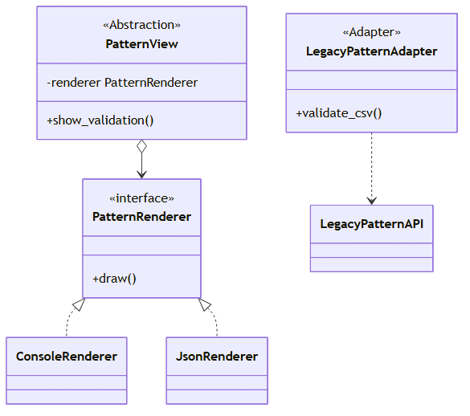

# Отчет 3

Тема: Структурные паттерны: Адаптер, Мост

## Исходный код

```python
"""ЛР3: Bridge + Adapter."""

from __future__ import annotations

from abc import ABC, abstractmethod

from src.domain.pattern import PatternValidationResult, normalize_raw_points


class PatternRenderer(ABC):
    @abstractmethod
    def draw(self, points: list[int], message: str) -> str: ...


class ConsoleRenderer(PatternRenderer):
    def draw(self, points: list[int], message: str) -> str:
        return f"[консоль] точки={points} | {message}"


class JsonRenderer(PatternRenderer):
    def draw(self, points: list[int], message: str) -> str:
        return f'{{"points": {points}, "status": "{message}"}}'


class PatternView:
    """Мост: абстракция UI отделяет рендерер."""

    def __init__(self, renderer: PatternRenderer) -> None:
        self._renderer = renderer

    def show_validation(self, points: list[int]) -> str:
        r = normalize_raw_points(points)
        msg = "ok" if r.ok else r.message
        return self._renderer.draw(list(r.normalized) or points, msg)


class LegacyPatternAPI:
    """Старый API: строка '0,1,2,5'."""

    def parse(self, csv: str) -> list[int]:
        return [int(x) for x in csv.split(",") if x.strip()]


class LegacyPatternAdapter:
    """Адаптер к новому валидатору."""

    def __init__(self, legacy: LegacyPatternAPI) -> None:
        self._legacy = legacy

    def validate_csv(self, csv: str) -> PatternValidationResult:
        return normalize_raw_points(self._legacy.parse(csv))
```

## Диаграмма классов



Адаптер и Мост

## Описание паттернов

Мост. PatternView показывает результат проверки шаблона. Как выглядит эта строка, решает отдельный класс: ConsoleRenderer пишет текст для консоли, JsonRenderer собирает JSON. В конструктор передаётся нужный вариант.

Адаптер. Старый интерфейс отдаёт точки одной строкой, например 0,1,2,5. LegacyPatternAPI режет строку на числа, LegacyPatternAdapter отправляет их в обычную проверку шаблона.
