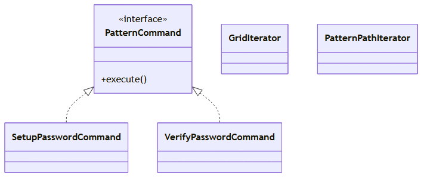

# Отчет 7

Тема: Поведенческие паттерны: Команда, Итератор

## Исходный код

```python
"""ЛР7: Команда + Итератор."""

from __future__ import annotations

from abc import ABC, abstractmethod


class PatternCommand(ABC):
    @abstractmethod
    def execute(self) -> str: ...


class SetupPasswordCommand(PatternCommand):
    def __init__(self, facade, points: list[int]) -> None:
        self._facade = facade
        self._points = points

    def execute(self) -> str:
        ok, msg = self._facade.setup(self._points)
        return f"SETUP ok={ok} {msg}"


class VerifyPasswordCommand(PatternCommand):
    def __init__(self, facade, points: list[int]) -> None:
        self._facade = facade
        self._points = points

    def execute(self) -> str:
        ok, msg = self._facade.unlock(self._points)
        return f"VERIFY ok={ok} {msg}"


class GridIterator:
    def __init__(self, size: int = 9) -> None:
        self._size = size
        self._index = 0

    def __iter__(self):
        self._index = 0
        return self

    def __next__(self) -> int:
        if self._index >= self._size:
            raise StopIteration
        value = self._index
        self._index += 1
        return value


class PatternPathIterator:
    """Итератор по точкам заданного шаблона."""

    def __init__(self, points: list[int]) -> None:
        self._points = points
        self._i = 0

    def __iter__(self):
        self._i = 0
        return self

    def __next__(self) -> int:
        if self._i >= len(self._points):
            raise StopIteration
        p = self._points[self._i]
        self._i += 1
        return p
```

## Диаграмма классов



Команда и Итератор

## Описание паттернов

Команда. Задать пароль и проверить его оформлены отдельными классами: SetupPasswordCommand и VerifyPasswordCommand. У обоих есть метод execute(), внутри он вызывает setup или unlock у фасада.

Итератор. GridIterator по очереди выдаёт номера клеток от 0 до 8. PatternPathIterator так же проходит по уже набранному списку точек шаблона.
